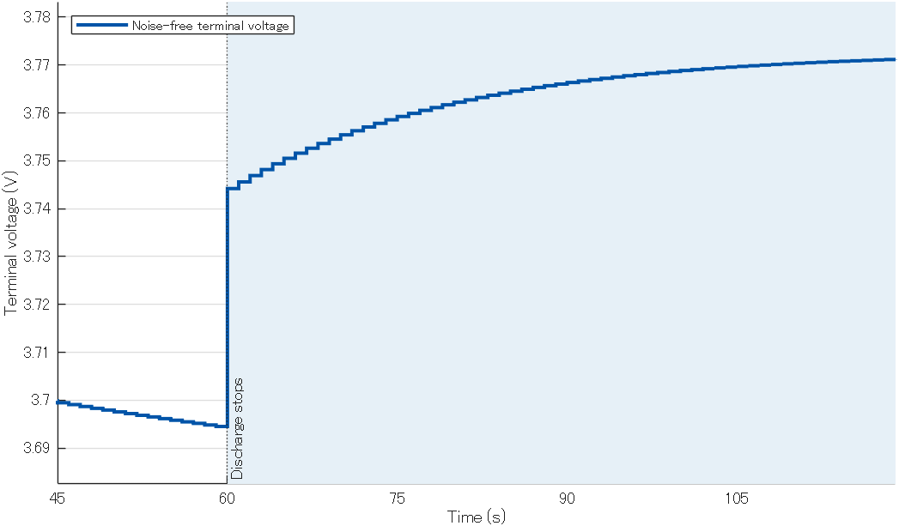
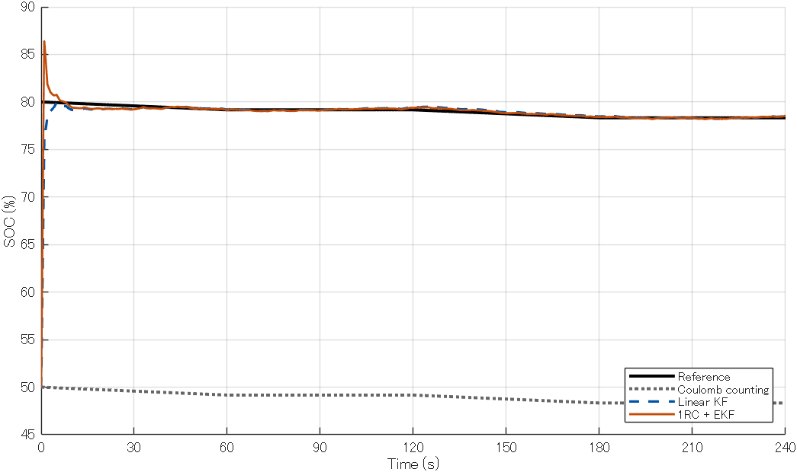

# Simulinkで学ぶ電池のSOC推定 ― 電流積算から1RCモデル＋EKFまで

2026年11月11日 · 電池・制御

電池の残量を表すSOC（State of Charge、充電率）は、電流を積算すると変化量が分かります。では、起動時のSOCを50%と見積もった電池が、実際には80%だったら、運転中にどう補正できるのでしょうか。

MATLAB and Simulink Home Suiteで、電流積算、通常のカルマンフィルタ、1RC等価回路と拡張カルマンフィルタ（EKF）の順に試しました。モデルの作成と実行結果の確認には、MATLAB MCP Serverを接続したCodexを使いました。

## Simulinkモデルをダウンロード

[3本のSimulinkモデルをダウンロード（ZIP）](../assets/battery-soc/simulink-soc-models.zip)

ZIPを展開し、MATLABとSimulinkで `.slx` ファイルを開きます。**実行（Run）** を押すと240秒分のシミュレーションが走ります。**Compare SOC** を開くと基準値と推定値を、3本目の **Terminal voltage** を開くと端子電圧を確認できます。動作確認には MATLAB / Simulink R2025a Update 1 を使いました。

| ファイル | 内容 |
| --- | --- |
| [`soc_01_coulomb_counting.slx`](../assets/battery-soc/soc_01_coulomb_counting.slx) | 電流積算 |
| [`soc_02_kalman_filter.slx`](../assets/battery-soc/soc_02_kalman_filter.slx) | 直線OCVと通常のカルマンフィルタ |
| [`soc_03_1rc_ekf.slx`](../assets/battery-soc/soc_03_1rc_ekf.slx) | 非線形OCVと1RCモデル＋EKF |

配布版の電流積算モデルは、記事の条件を再現できるように **Estimated SOC** ブロックの初期値を50%に設定しています。

## 1. 電流積算では初期SOCのずれが残る

容量2 Ahの電池を1 Aで60秒放電し、60秒休止するサイクルを2回繰り返しました。シミュレーション上の基準SOCは80%、推定側の初期値は50%です。以降、放電電流を正とし、SOCは0〜100の数値で扱います。

1回の放電で取り出す電荷は1 A × 60秒 ÷ 3600 = 0.0167 Ahです。容量2 Ahに対してSOCは約0.83ポイント下がります。基準と推定には同じ電流を入れるので、どちらも同じ量だけ減り、休止中は一定です。240秒後には基準が78.33%、推定が48.33%となり、初期値の差30ポイントが残りました。

## 2. 通常のカルマンフィルタで端子電圧から補正する

SOCから開回路電圧（OCV）を求め、電流が流れているときは直列抵抗による電圧降下を引きます。この段階では、OCVとSOCの関係を直線で近似しました。SOCの数値を `s`、電流を `I`、直列抵抗を `R₀` とすると、端子電圧の予測式は次のとおりです。

> 予測端子電圧 = 3.0 + 0.012 × 予測SOC − I × R₀

電流積算でSOCを予測したあと、測定電圧と予測端子電圧の差を使って補正します。

> 補正後のSOC = 予測SOC + K × (測定電圧 − 予測端子電圧)

カルマンゲイン `K` は電圧のずれをSOCの補正量に換算します。ゲインの計算には、予測誤差の共分散と測定ノイズの分散を使います。初期誤差の分散 `P₀` は起動直後の補正に影響し、プロセスノイズの分散 `Q` は予測のたびに見込む不確かさ、測定ノイズの分散 `R` は電圧測定の不確かさを表します。

今回の模擬測定では、50%から始めた推定SOCが240秒後に78.57%まで近づきました。

## 3. 1RCモデルで休止中の電圧の戻りを表す

電池の等価回路に、抵抗とコンデンサを並列にしたRC枝を1つ加えました。端子電圧の予測には、その枝にかかる電圧 `V_RC` も使います。

> 予測端子電圧 = OCV(予測SOC) − I × R₀ − 予測V_RC

放電を止めると、直列抵抗による電圧降下 `I × R₀` が消え、端子電圧がすぐに上がります。続いて `V_RC` が時間をかけて減衰するため、端子電圧はさらにゆっくり上がります。最初の休止中、基準SOCは79.17%で一定でしたが、測定ノイズを加える前の端子電圧は3.744 Vから3.771 Vに戻りました。Scopeで両方の波形を見比べると、SOCが一定のまま電圧が変わることを確認できます。

*図1　1RCモデルの端子電圧（測定ノイズを加える前）。青く塗った区間が休止中です。*

## 4. OCVを曲線にするとEKFが必要になる理由

最後のモデルでは、OCVとSOCの関係も直線から曲線に変えました。EKFは予測端子電圧の計算にOCV曲線を使い、カルマンゲインを求めるときは予測SOCの位置で曲線の傾きを計算します。状態ベクトルを `[SOC, V_RC]ᵀ` としたときの観測ヤコビアンは `H = [dOCV/dSOC, −1]` です。第1成分はSOCの変化が予測電圧にどれだけ効くか、第2成分は `V_RC` が増えた分だけ予測電圧が下がることを表します。

RC枝を加えると、推定する状態がSOCと `V_RC` の2つになります。OCVが直線で、抵抗や容量などのパラメータが一定なら、1RCモデルでも通常のカルマンフィルタを使えます。今回EKFを選んだ理由は、OCV曲線によって観測式が非線形になったためです。

## 240秒後の推定結果

*図2　配布モデルを実行して得たSOCの時系列。EKFは最初の補正で基準値を一度上回り、その後基準値付近に近づきます。*

| 方法 | 初期の推定SOC | 240秒後の基準SOC | 240秒後の推定SOC |
| --- | ---: | ---: | ---: |
| 電流積算 | 50% | 78.33% | 48.33% |
| 直線OCV＋通常のカルマンフィルタ | 50% | 78.33% | 78.57% |
| 非線形OCV＋1RCモデル＋EKF | 50% | 78.33% | 78.55% |

2つのフィルタには、それぞれの電池モデルが生成した模擬端子電圧を使いました。表の数値は各モデルで初期SOCのずれをどこまで補正できたかを示します。同一条件での精度比較には、共通の端子電圧データを使う必要があります。

## 参考資料

- 足立修一・丸田一郎・長村謙介「カルマンフィルタを用いた二次電池の充電率推定」『計測と制御』56巻9号、691–694頁、2017年。[J-STAGE](https://www.jstage.jst.go.jp/article/sicejl/56/9/56_691/_article/-char/ja)
- MathWorksのSOC Estimatorブロックの解説。1RC等価回路の状態方程式と観測方程式を参照できます。[MathWorksドキュメント](https://www.mathworks.com/help/simscape-battery/ref/socestimatorkalmanfilter.html)

[記事一覧に戻る](../index.md)
